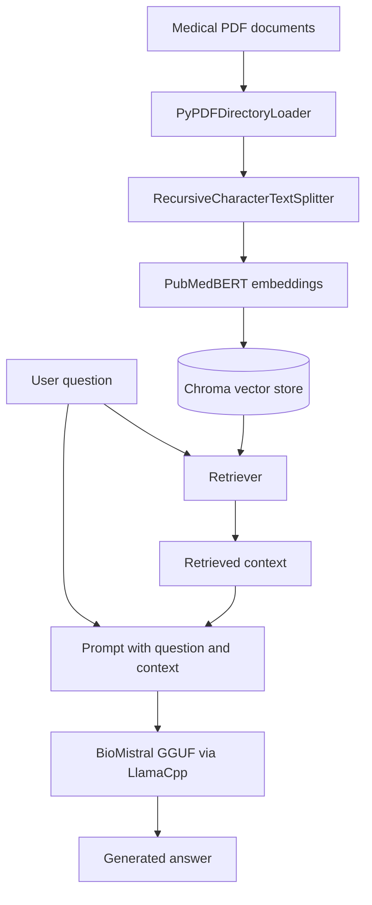

# BioMistral Medical RAG Chatbot 🩺

A **medical document question-answering chatbot** built with **BioMistral**, **LangChain**, **PubMedBERT embeddings**, and **ChromaDB**. The project uses Retrieval-Augmented Generation (RAG) to retrieve relevant passages from medical PDFs and generate context-informed answers with a locally loaded GGUF language model.

> **Medical disclaimer:** This project is an educational prototype, not a medical device. Its answers may be inaccurate, incomplete, or outdated. Do not use it for diagnosis, treatment decisions, emergencies, or as a substitute for a qualified healthcare professional.

## Features

- Loads multiple medical PDF files from Google Drive in Google Colab.
- Splits extracted text into overlapping chunks for retrieval.
- Encodes document chunks using `NeuML/pubmedbert-base-embeddings`.
- Stores and searches embeddings with ChromaDB.
- Runs a BioMistral GGUF model through `llama-cpp-python` and LangChain's `LlamaCpp` integration.
- Supports an interactive command-line question-and-answer loop.

## RAG Architecture



## Technology Stack

| Component | Technology |
| --- | --- |
| Language | Python |
| Notebook environment | Google Colab |
| LLM | BioMistral (GGUF format) |
| RAG orchestration | LangChain |
| PDF loader | PyPDFDirectoryLoader |
| Text splitter | RecursiveCharacterTextSplitter |
| Embedding model | `NeuML/pubmedbert-base-embeddings` |
| Vector database | ChromaDB |
| Local LLM inference | `llama-cpp-python` |
| Document storage | Google Drive |

## Project Structure

Suggested repository layout:

```text
BioMistral-Medical-RAG-Chatbot/
├── README.md
├── requirements.txt
├── BioMistral_Medical_RAG.ipynb
├── Data/                    # Add only documents you are allowed to share
└── .gitignore
```

The model file (`*.gguf`) and private medical documents should **not** be committed to GitHub. Download the model separately from its authorized distribution source and review its license.

## Installation and Setup

### 1. Clone the repository

```bash
git clone https://github.com/<your-username>/BioMistral-Medical-RAG-Chatbot.git
cd BioMistral-Medical-RAG-Chatbot
```

Replace `<your-username>` with your GitHub username.

### 2. Install dependencies

In Google Colab, run:

```python
%pip install -U langchain langchain-community langchain-text-splitters langchain-huggingface langchain-chroma langchain-core sentence-transformers chromadb llama-cpp-python pypdf
```

`llama-cpp-python` may need a compatible build and can take time to install. Restart the notebook runtime after installation if needed.

### 3. Mount Google Drive

```python
from google.colab import drive
drive.mount('/content/drive')
```

Organize your Drive files as follows:

```text
MyDrive/
└── BioMistral/
    ├── Data/
    │   ├── medical_document_1.pdf
    │   └── medical_document_2.pdf
    └── BioMistral-78.04K.M.gguf
```

The GGUF filename above is taken from the original notebook. Confirm that it matches the model file you actually downloaded; the model's exact identity and quantization are not verified here.

### 4. Use updated imports

Recent LangChain versions moved several classes into separate packages:

```python
from langchain_community.document_loaders import PyPDFDirectoryLoader
from langchain_text_splitters import RecursiveCharacterTextSplitter
from langchain_huggingface import HuggingFaceEmbeddings
from langchain_chroma import Chroma
from langchain_community.llms import LlamaCpp
from langchain_core.prompts import ChatPromptTemplate
from langchain_core.runnables import RunnablePassthrough
from langchain_core.output_parsers import StrOutputParser
```

### 5. Load and chunk PDF documents

```python
loader = PyPDFDirectoryLoader('/content/drive/MyDrive/BioMistral/Data')
docs = loader.load()

text_splitter = RecursiveCharacterTextSplitter(
    chunk_size=300,
    chunk_overlap=50
)
chunks = text_splitter.split_documents(docs)
print('Chunks created:', len(chunks))
```

### 6. Create embeddings and a vector store

```python
embeddings = HuggingFaceEmbeddings(
    model_name='NeuML/pubmedbert-base-embeddings'
)
vectorstore = Chroma.from_documents(
    documents=chunks,
    embedding=embeddings
)
```

The referenced embedding model is publicly available; a Hugging Face API token is not normally required to download it. Never hard-code access tokens in notebooks committed to GitHub.

### 7. Load BioMistral

```python
llm = LlamaCpp(
    model_path='/content/drive/MyDrive/BioMistral/BioMistral-78.04K.M.gguf',
    temperature=0.2,
    max_tokens=2048,
    top_p=1
)
```

Model compatibility, runtime memory requirements, and performance depend on the actual GGUF file and Colab hardware.

### 8. Build the RAG chain

```python
prompt = ChatPromptTemplate.from_template('''
You are a medical document assistant. Answer using only the provided context.
If the context does not contain enough information, say so.
Do not provide definitive diagnoses or personalized treatment advice.

Context:
{context}

Question:
{query}

Answer:
''')

rag_chain = (
    {
        'context': vectorstore.as_retriever(),
        'query': RunnablePassthrough(),
    }
    | prompt
    | llm
    | StrOutputParser()
)
```

**Important fix:** The original prompt defined `{query}` but did not include `{context}`. Without a `{context}` placeholder, retrieved PDF passages are not included in the prompt sent to the LLM. The revised template corrects this.

### 9. Ask questions

```python
while True:
    user_input = input('Input query (or exit): ').strip()
    if user_input.lower() == 'exit':
        print('Exiting...')
        break
    if not user_input:
        continue
    print('Answer:', rag_chain.invoke(user_input))
```

## Example Queries

Try questions relevant to the PDFs you uploaded, such as:

- What does the document say about diabetes risk factors?
- Summarize the discussion of hypertension.
- What symptoms are described for the condition covered in this PDF?
- Which preventive measures are mentioned in the uploaded medical literature?

**Note:** Outputs depend on the documents and model. These are example inputs, not verified demonstrations or measured results.

## How It Works

1. **Document ingestion:** `PyPDFDirectoryLoader` extracts text from PDFs.
2. **Chunking:** `RecursiveCharacterTextSplitter` divides text into chunks of 300 characters with a 50-character overlap.
3. **Embedding:** PubMedBERT-based embeddings convert chunks into numerical vectors.
4. **Indexing:** ChromaDB stores the vectors for similarity search.
5. **Retrieval:** The retriever selects relevant document chunks for each question.
6. **Generation:** BioMistral receives the retrieved context and question and produces an answer.

## Current Limitations

- No formal medical accuracy or safety evaluation has been performed.
- The chatbot may hallucinate or provide unsupported answers.
- PDF extraction quality depends on document formatting; scanned PDFs may require OCR.
- The current chain does not display source citations or page numbers in the answer.
- The Chroma store is in-memory/ephemeral in the example and is recreated on rerun.
- The notebook requires the user to supply a compatible GGUF model and adequate compute resources.
- The current interface is a notebook/terminal input loop, not a web application.

## Future Enhancements

- Add citations with PDF filenames and page numbers.
- Implement retrieval quality and answer-grounding evaluation.
- Add a Streamlit or Gradio chat interface.
- Persist ChromaDB embeddings to avoid repeated indexing.
- Introduce confidence/abstention handling for insufficient evidence.
- Add safeguards for medical emergencies and unsafe clinical recommendations.
- Improve deployment configuration and reproducibility with pinned dependency versions.

## Responsible Use and Privacy

Use only documents you have permission to process. Avoid uploading identifiable patient records to public repositories or unapproved environments. Treat generated medical information as unverified and seek professional advice for medical concerns.

## Acknowledgments

This project uses open-source tools and models from the LangChain, ChromaDB, llama.cpp, BioMistral, and Hugging Face ecosystems.
